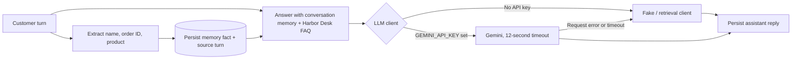

# Conversation Memory Bot

A small Harbor Desk support chatbot that extracts useful details from a conversation, stores them as session-scoped facts, and reuses them in later answers. The demo runs locally with a deterministic fake LLM client and can optionally use Google Gemini.

## How the AI design works



The extraction and persistence step runs before answer generation. Each memory fact records its source user turn, and the latest value for a fact replaces the previous value within that chat session. Gemini is behind `App\Services\Llm\LlmClient`; a request error or timeout falls back to a useful local answer instead of breaking the chat.

## Run locally (no API key needed)

Requirements: PHP 8.3+, Composer, Node.js 22+, and npm.

```bash
composer install
cp .env.example .env
php artisan key:generate
php -r "file_exists('database/database.sqlite') || touch('database/database.sqlite');"
php artisan migrate --seed
npm install
npm run build
composer run dev
```

On Windows PowerShell, replace `cp .env.example .env` with `Copy-Item .env.example .env`.

Open [http://localhost:8000](http://localhost:8000). The app uses SQLite, file-backed sessions, and a deterministic `FakeLlmClient` when `GEMINI_API_KEY` is blank; no account, credentials, Redis, or external service is needed. The database seeder creates one fictional Harbor Desk FAQ about shipping and returns. There are no demo login credentials because chat is available to guests.

To use Gemini, set `GEMINI_API_KEY` in `.env` and restart the app. The default model is `gemini-2.5-flash`; `GEMINI_MODEL` can override it. Requests have a 12-second timeout, and failures use the local fallback.

## Try the memory

1. Send: `I am Maya, order HD-22`.
2. The sidebar shows the extracted name and order number.
3. Ask: `what is my order?` and the reply uses `HD-22` from the earlier turn.
4. Use **Reset chat** to delete the conversation and its memory.

Name, order ID, and product facts are scoped to the browser's chat session. This is a product demo and should only be used with fictional sample information.

## Tests and checks

```bash
composer test
composer ci:check
```

The Pest feature tests bind `FakeLlmClient` and verify that a guest can post a message, `I am Maya, order HD-22` creates a memory fact linked to its source turn, a later order question is answered with the saved order ID, the FAQ provides shipping guidance, reset clears turns and memory, and an LLM failure still returns a useful answer. `composer ci:check` also runs frontend checks and Vue/TypeScript type checking.

## Stack

- Laravel 13, PHP 8.3, SQLite, and Pest
- Vue 3, Inertia, TypeScript, and Tailwind CSS
- `LlmClient` abstraction with a deterministic local fake and optional Gemini implementation
